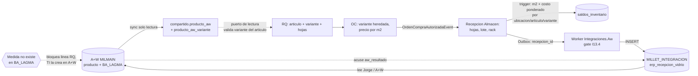

# 02 · Diseño E07 — Artículo del ERP ↔ producto de A+W para vidrio crudo por medida

> **Ticket:** ClickUp 86e3tuyn2 (E07). **Habilita:** F1-MP-01 (86e3jvufe, A4.1), F1-MP-05 (86e3jvujm), F1-COM-09 (86e3jvu83, C3.2).
> **Estado:** propuesta para validar con Eliam. Lo no confirmado por Millet o por código va marcado **SUPUESTO**.
> **Parte de:** borrador de Eliam (22-oct). Se conservan sus decisiones (§1) y se cierran los huecos con referencias al código.

## 0. Contexto y cambio de alcance

- Millet respondió (cuestionario 02, Compras/Almacén/Producción): **todas las materias primas, incluido el vidrio crudo, se compran desde el ERP**. Esto **reemplaza** la exclusión del vidrio crudo en `00-levantamiento.md` (l.46-47 «solo el vidrio crudo queda fuera», l.71, l.93, l.653, l.775). Pendiente: actualizar esas líneas al cerrar F1-MP-01.
- El software de Almacenes de Jorge conserva la captura física por pieza y rack (JUNTA-07). El ERP recibe sus movimientos; no lo sustituye.
- A+W sigue siendo dueño de productos, variantes y retazos. El ERP **solo lee** A+W por SQL (`CLAUDE.md`, anti-scope; `docs/integration/06` §1).

## 1. Decisiones de Eliam que se conservan

| # | Decisión |
|---|---|
| E1 | `Articulo.ProductoAwId` 1:1, nullable (familia de A+W). |
| E2 | La medida viaja como `ProductoAwVarianteId` en partidas de RQ, OC, líneas de movimiento y en el saldo. |
| E3 | Saldo y costo por artículo + variante + ubicación; se manejan hojas con m² calculados. |
| E4 | Ejemplo «50 hojas 3.30 × 2.14» de punta a punta (§8). |
| E5 | Pregunta a Millet sin bloquear: ¿el vidrio se cotiza por hoja o por m²? (§4). |

## 2. Dónde vive la variante y regla entre módulos

**Hoy** (verificado):

- `ProductoAwVariante` (`backend/src/DatosMaestros/Domain/ProductoAwVariante.cs:11`) vive en el esquema `compartido`, tabla `producto_aw_variante`, configurada en `CompartidoDbContext.cs:1559-1571`: `UNIQUE (producto_aw_id, clave_variante)`, `alto_mm`, `ancho_mm`, `espesor_mm` (precisión 12,3, nulos = «no informado»).
- `Articulo` (`DatosMaestros/Domain/Articulo.cs:20`) **no** tiene `ProductoAwId`. Las líneas de RQ (`Compras/Domain/LineaRequisicion.cs:30`), de OC (`Compras/Domain/Oc/LineaOrdenCompra.cs:35`) y de movimiento (`Almacen/Domain/Movimientos/LineaMovimiento.cs:22`) solo tienen `ArticuloId`, sin FK entre módulos (`LineaMovimientoConfiguration.cs:27`).
- El contrato de lectura `ProductoAwContratoV1` (`Compartido/Infrastructure/PublicAdapters/ProductoAwContratoReadAdapter.cs:29-31`, puerto `IProductoAwContratoReadPort`) devuelve las variantes **sin su `Id`**: solo `claveVariante`, medidas y composición.

**Decisiones:**

- **D1. La variante se queda en `compartido.producto_aw_variante`.** Es dato de A+W sincronizado (doc 06 §3); no se duplica en Almacén ni Compras.
- **D2. Sin FK de base de datos desde Almacén/Compras hacia `producto_aw_variante`.** Son esquemas y `DbContext` distintos (ADR-0030, regla de oro de la triada: cero acceso a tablas de otro módulo). `producto_aw_variante_id` es un `uuid` plano, igual que `articulo_id` hoy.
- **D3. La integridad se valida en el borde con un puerto de lectura**, mismo patrón que `ProductoAwContratoReadAdapter`:
  - Ampliar `ProductoAwVarianteContratoV1` con `Id` (cambio **aditivo**, `VersionContrato` sigue `"1"` según doc 06 §9).
  - Nuevo puerto `IVarianteVidrioReadPort.ObtenerAsync(articuloId, varianteId)` en `SharedKernel`/`Compartido` (adaptador sobre `CompartidoDbContext`) que devuelve `{ varianteId, claveVariante, anchoMm, altoMm, espesorMm, activa }` y **falla** si la variante no pertenece al `ProductoAwId` del artículo, o si el producto/variante está inactivo (doc 06 §7: inactivo bloquea uso nuevo).
  - Se invoca al **capturar** la línea de RQ, al **crear/editar** la línea de OC y al **registrar** la recepción. Los snapshots (`ancho_mm`, `alto_mm`) se copian a la línea para que un cambio posterior en A+W no reescriba el histórico (mismo criterio que `UnidadMedida` snapshot en líneas).
- **D4. Solo el vidrio crudo/float tiene variantes por medida.** El vidrio tratado (templado, laminado) es otro código A+W sin herencia (doc 06 §5); no entra a este diseño y no se compra como materia prima por medida.
- **D5. Vínculo `Articulo` ↔ `ProductoAw`** (**SUPUESTO**, a validar con Eliam): lo captura **a mano un administrador en Datos Maestros** (selector de producto A+W en el formulario del artículo; permiso ya existente `datos_maestros.productos-aw.gestionar` para leer, y el de gestionar artículos para escribir). No hay emparejamiento automático por descripción: los catálogos nacieron separados (ADR-0048 D5, doc 06 §1). Reglas:
  - `Articulo.ProductoAwId` es `uuid NULL`, índice único filtrado `WHERE producto_aw_id IS NOT NULL` (1:1 también hacia el lado A+W).
  - Solo se puede fijar si el producto es de tipo vidrio crudo (criterio de tipo/grupo `BA_PRODUKTART`/`BA_WGR`, **SUPUESTO**, depende de los `TiposExcluidos` de doc 06 §11) y se puede quitar solo si ningún saldo ni línea abierta lo usa.
  - Artículo con `ProductoAwId` ⇒ **exige** variante en RQ/OC/recepción. Artículo sin `ProductoAwId` (todo lo no-vidrio: interlayer, silicones, herrajes…) ⇒ la variante es **NULL y se rechaza si llega**. Esto es una regla de dominio de la línea, no de la UI.

## 3. Variante faltante y retazos

- **Medida que no está en `BA_LAGMA`** (no hay variante en `producto_aw_variante`): la solicitud de alta sale **desde la requisición**. Quien captura indica la medida nueva (`ancho_mm × alto_mm`) y la línea queda en espera de alta de medida (sin `ProductoAwVarianteId`, con la medida solicitada). El ERP escribe la solicitud completa en una tabla puente nueva de `MILLET_INTEGRACION` (`dbo.erp_solicitud_alta_medida`, mismo patrón que `erp_otr_estado`, doc 09): `solicitud_id` (idempotencia), `producto_ref` (`BA_PRODUKT`), `ancho_mm`, `alto_mm`, `espesor_mm`, folio de RQ, solicitante y fecha, más acuse `aw_resultado`/`aw_motivo`/`aw_atendida_at`. TI ve la lista con todos los datos y da de alta en A+W sin pedir información; marca el acuse (rechazo con motivo vuelve a la RQ). En la siguiente sincronización el ERP liga la variante a la línea por `producto_aw_id + clave_variante` y la RQ sigue sin recapturarse. Solicitudes repetidas de la misma familia y medida se agrupan en una. La RQ no avanza a OC mientras la línea espere (`VARIANTE_VIDRIO_REQUERIDA`). **El ERP nunca crea variantes** ni escribe en `BA_LAGMA` (A+W es solo lectura, doc 06 §1). Escritura de la tabla gated por la misma conexión que §6; mientras no esté, la lista se consulta en una pantalla del ERP. **SUPUESTO:** columnas finales las valida TI (Jorge); atención el mismo día hábil. Caso ya conocido: «10MM CLARO 1100×2100» no está en `BA_LAGMA` (doc 06 §11).
- **Retazos** viven en A+W (D07). No hay saldo de retazos en el ERP. Una hoja que se corta y deja retazo: el ERP ve la salida de la hoja entera; el retazo lo gestiona A+W.

## 4. Unidades: existencia y costo en m², captura en hojas

- **Unidad de existencia y costo = `M2`** (A+W guarda el vidrio en `m²`, doc 06 §3; `M2` ya existe en el catálogo, migración Compartido `20261001183414_UnidadMedidaAreaM2M3`). `Articulo.UnidadMedidaDefault = "M2"`.
- **Unidad de captura = hoja**, con el mecanismo existente `LineaMovimiento.CantidadCapturada` / `UnidadCapturada` (`LineaMovimiento.cs:28-36`, `AsentarCaptura`, ya usado en `RegistrarRecepcionConFacturaCommand.cs:260`). `Cantidad` guarda los m².
- **El factor hoja → m² no es fijo por unidad: depende de la variante.** `ConversionUnidadAdapter.ConvertirAsync(articuloId, cantidad, unidadCapturada, unidadDocumento)` (`Compartido/Infrastructure/PublicAdapters/ConversionUnidadAdapter.cs:11-44`) convierte solo con factores del catálogo de unidades de la misma dimensión; no conoce variantes. **Decisión D6:** cuando la línea trae variante y la unidad capturada es `HOJA`, el factor sale de la variante:
  `m2_por_hoja = ROUND(ancho_mm × alto_mm / 1 000 000, 4)`; `Cantidad(m²) = hojas × m2_por_hoja`.
  Se implementa como función pura (`AreaHojaM2`) usada por un overload del puerto con `varianteId`; se redondea **por hoja** (no al total) para que 50 hojas = 50 × una hoja y los decimales respeten `numeric(14,4)`.
  `HOJA` se da de alta en el catálogo de unidades solo como etiqueta de captura (dimensión «Conteo»); la conversión a m² nunca pasa por su `FactorABase`.
- **Precio de OC: por m² por omisión** (`LineaOrdenCompra.PrecioUnitario` con `UnidadMedida = "M2"`), porque el costo del saldo es MXN/m² y evita conversiones al valuar. **Pregunta a Millet (no bloquea la construcción):** ¿el proveedor cotiza por hoja o por m²? Si es por hoja, la OC conserva el precio por hoja capturado y el sistema deriva `precio_m2 = precio_hoja / m2_por_hoja` al recibir (la OC en firme sigue siendo la fuente del costo; regla de la triada).
- Cantidades de RQ y OC: se piden en **hojas** (como compra el comprador) y se muestran los m² derivados; `CantidadRecibida` y el acumulado de cubrimiento de la OC se llevan en la unidad de la línea (hojas) con los m² en la línea de movimiento. **SUPUESTO:** la RQ/OC conserva su unidad en hojas y no se convierten los acumulados a m².

## 5. Saldo y costo por variante

### 5.1 Estado actual (corrige el enunciado del borrador)

La llave del saldo **ya no es** `(sub_almacen, artículo)`: tras ADR-0047 es **`(ubicacion_id, articulo_id)`** (`SaldoInventarioConfiguration.cs:38` `HasKey({UbicacionId, ArticuloId})`; `SubAlmacenId` está denormalizado, `SaldoInventario.cs:41-49`). La función vigente del trigger **no** es la de `20260523010136_MovimientosYSaldos.cs` (~l.314): fue reemplazada varias veces; la última es **`20261020224330_AlmacenCostoExpedienteP1.cs:98-215`** (`ActualizarTrigger`, `ON CONFLICT (ubicacion_id, articulo_id)` en l.~170, costo ponderado a 4 o 12 decimales). La reescritura parte de **esa** versión, no de la original.

### 5.2 Nueva llave

- Columna nueva `almacen.saldos_inventario.producto_aw_variante_id uuid NULL` y la misma columna en `almacen.lineas_movimiento` (junto con `ancho_mm`/`alto_mm` snapshot, ver §5.4).
- **Llave natural: `(ubicacion_id, articulo_id, producto_aw_variante_id)` + `lote`** (ver S7, §11) (la ubicación ya determina el sub-almacén). La existencia sigue contándose en la ubicación (rack), alineado con la captura por rack de Jorge.
- **NULL (artículos sin variante):** un PK no admite NULL, así que el saldo pasa a **PK sustituto `id uuid`** + **índice único `ux_saldos_ubic_art_var` sobre las tres columnas con `NULLS NOT DISTINCT`**. PostgreSQL ≥ 15 lo soporta; **el proyecto usa 16** (`docker-compose.dev.yml:23` `postgres:16-alpine`; `infra/modules/database.bicep:38` `postgresVersion = '16'`). Precedente en el repo: `AreNullsDistinct(false)` en `Contabilidad/.../DimensionesConfigurations.cs:49` (Npgsql EF 10.0.3). Alternativa descartada: uuid centinela `Guid.Empty` para «sin variante» (finge un valor que no existe en `producto_aw_variante`).
- El `ON CONFLICT` del trigger apunta al índice único: `ON CONFLICT (ubicacion_id, articulo_id, producto_aw_variante_id) DO UPDATE …` (válido con `NULLS NOT DISTINCT`).

### 5.3 Reescritura de `fn_movimientos_actualizar_saldo`

Mismo cuerpo vigente (20261020224330), con estos cambios y nada más:

1. `INSERT` del saldo incluye `producto_aw_variante_id = NEW.producto_aw_variante_id`.
2. `ON CONFLICT` por la llave de tres columnas.
3. El `SELECT … FOR UPDATE` y el `UPDATE` de salida filtran `producto_aw_variante_id IS NOT DISTINCT FROM NEW.producto_aw_variante_id`.
4. Mensajes `SALDO_INEXISTENTE` / `SALDO_INSUFICIENTE` agregan `variante=%`.
5. **Costo promedio ponderado por variante** (no por artículo): la fórmula actual `((cant_ant × costo_ant) + (cant_ent × costo_ent)) / (cant_ant + cant_ent)` se aplica a la fila de la variante, con `cantidad` y `costo` ya en m². Las demás reglas (ubicación default, inactiva, multi-subalmacén) no cambian.
6. Defensa extra en el trigger: `CHECK` en `lineas_movimiento` de que `producto_aw_variante_id` y `ancho_mm`/`alto_mm` van juntos (los tres nulos o los tres informados).

**Migración de datos:** las filas existentes quedan con variante `NULL` (no-vidrio). Un artículo que pasa a tener `ProductoAwId` con saldo previo sin variante **no** se permite (D5); se ajusta a cero antes.

### 5.4 Consumidores del saldo que hay que revisar (grep)

`SaldoInventario` se usa en ~20 archivos (`Almacen/Application/Saldos/SaldoQueries.cs`, `JerarquiaQueries.cs`, `Salidas/RegistrarSalidaConRequisicionCommand.cs`, `Vales/RegistrarSalidaPorValeCommand.cs`, `Conteos/*`, `Revision/DictaminarMaterialEnRevisionCommand.cs`, `DevolucionesInternas/*`, `Reportes/ExistenciaMpCnkQuery.cs`, `EventListeners/ExpedienteCostoDistribuidoHandler.cs`, adaptadores `AlmacenSaldoQueryAdapter.cs`, `RecepcionesCostoReadAdapter.cs` y `Compras/.../AlmacenStockReadAdapter.cs`). Regla de migración:
- **Lecturas de «existencia del artículo»** (Compras para repartir disponibilidad, reportes) → `SUM(cantidad)` sobre variantes, sin cambio de contrato.
- **Operaciones que localizan una fila** (salida, vale, conteo, dictamen, devolución interna) → reciben `varianteId` y filtran con `IS NOT DISTINCT FROM`; si el artículo exige variante y no llega, `VARIANTE_VIDRIO_REQUERIDA`.
- El ajuste de costo de expediente (`ExpedienteCostoDistribuidoHandler`) distribuye por variante, no por artículo.

### 5.5 Índices y volumen (4,500–6,000 m²/día)

A ~7 m² por hoja son ~650–850 hojas/día, es decir decenas de movimientos, no miles. El camino caliente es el upsert del trigger por la llave única de tres columnas (búsqueda por índice, sin escaneo). Índices:
- `ux_saldos_ubic_art_var` (único, `NULLS NOT DISTINCT`) — upsert y `FOR UPDATE`.
- Reemplazar `ix_saldos_con_stock (articulo_id, sub_almacen_id) WHERE cantidad > 0` (`SaldoInventarioConfiguration.cs:64`) por `(articulo_id, producto_aw_variante_id, sub_almacen_id) WHERE cantidad > 0` para «¿qué hojas tengo de este artículo/medida?».
- `lineas_movimiento`: índice `(articulo_id, producto_aw_variante_id)`; el existente `HasIndex(ArticuloId)` (`LineaMovimientoConfiguration.cs:54`) queda cubierto como prefijo y se puede reemplazar.
- Cardinalidad estimada: variantes de vidrio crudo × ubicaciones con stock; `BA_LAGMA` tiene 1,780 medidas en 678 productos en total (doc 06 §3), solo una fracción es vidrio crudo comprado. Sin particionado ni materialización adicional (**SUPUESTO**: revisar tras 3 meses de datos reales).

## 6. Recepción y envío a A+W (C3.2)

- **Dirección:** el ERP **no escribe en tablas internas de A+W**. Igual que el flujo 3 (`docs/integration/09-aw-otr-exportacion.md`, «Frontera y dependencias»), el ERP escribe en una **tabla puente nueva, definida por el ERP**, en `MILLET_INTEGRACION`: `dbo.erp_recepcion_vidrio` (propuesta; scripts SQL para Jorge siguiendo `docs/operacion/aw-integracion-scripts/07_create_otr_tables.sql` y `08_grant_otr.sql`). A+W (Jorge) la lee y da de alta el inventario de hojas; escribe el acuse en columnas `aw_*` (patrón `erp_otr_estado`).
- **Payload por línea recibida** (columnas, **SUPUESTO** hasta que Jorge valide qué necesita A+W):

| Columna | Origen |
|---|---|
| `recepcion_id` (uuid), `linea` | `almacen.movimientos_inventario.id` / posición — **llave de idempotencia** |
| `producto_ref` | `ProductoAw.ReferenciaExterna` (`BA_PRODUKT`) |
| `clave_variante` | `ProductoAwVariante.ClaveVariante` (`{Ancho}x{Alto}`, `AwProductosSqlOrigen.cs:225-231`) |
| `hojas`, `m2` | `CantidadCapturada` y `Cantidad` de la línea |
| `lote` | nuevo `LineaMovimiento.Lote` (no existe hoy: `LineaMovimiento.cs` no tiene lote) |
| `rack` | `Ubicacion.Clave` (Nivel 4, ADR-0047) |
| `pedimento`, `bl_guia`, `aduana`, `fraccion_arancelaria` | expediente de Comercio Exterior vía puerto de lectura (`Expediente.cs` ya modela pedimento; `ProductoAw` guarda fracción, doc 06 §3); nulos si es compra nacional |
| `oc_id`, `linea_oc_id`, `proveedor` | informativos |
| `erp_resultado`, `aw_acuse_at`, `aw_resultado`, `aw_motivo` | estado y acuse (patrón doc 09) |

- **Idempotencia:** `UNIQUE (recepcion_id, linea)`; reintento = misma fila. La entrega ocurre vía **Outbox** (ADR-0009) dentro de la misma transacción del movimiento: nuevo evento `OcRecepcionVidrioRegistradaEvent` o campo `ProductoAwVarianteId` en el evento `OcRecepcionRegistradaEvent` (hoy sin variante: `Compras/Domain/Ports/OrdenCompra/OcRecepcionRegistradaEvent.cs:24`); un worker en `Integraciones.Aw` lo inserta en el puente. Consumidores del evento idempotentes por `recepcion_id` (regla de la triada).
- **Candado I13.4:** el contrato **no está firmado**. La salida queda apagada por omisión, bajo una sección nueva de configuración (`IntegracionesAw:RecepcionVidrio`, `SalidaHabilitada=false`, `ContratoI134Firmado=false`, mismo candado real que `Exportacion`, `Integraciones.Aw/Infrastructure/Exportacion/DependencyInjection.cs:29`). Mientras tanto la recepción se registra y valúa en el ERP; las filas del puente quedan «Pendiente» sin enviarse. `PLATFORM-TODO(<AwRecepcionVidrioPuente>)`.
- **Modo Demo** con origen PostgreSQL sintético como el flujo 3 (`tools/aw-origen-demo`); nunca en Production.

## 7. Cómo viaja la medida de RQ a OC a recepción

| Paso | Qué se captura / valida | Dónde se guarda |
|---|---|---|
| RQ | Artículo de vidrio + variante + hojas. Valida D3. | `LineaRequisicion.ProductoAwVarianteId`, snapshot `AnchoMm/AltoMm`. Migración en Compras. |
| OC | Hereda variante de la línea de RQ (o se captura si no hay RQ previa); precio por m² (§4). Una OC no mezcla variantes en una línea. | `LineaOrdenCompra.ProductoAwVarianteId` + snapshots. |
| Recepción (A o B) | Elige línea de OC (la variante viene de ella; **no se puede cambiar**), captura hojas (`HOJA`), lote, rack. | `LineaMovimiento` con `ProductoAwVarianteId`, `Lote`, `CantidadCapturada=hojas`, `Cantidad=m²`. |
| Saldo | Trigger por llave de 3 columnas (§5). | `saldos_inventario`. |
| A+W | Fila en tabla puente (§6), gated por I13.4. | `MILLET_INTEGRACION`. |

Reglas de consistencia (de «consistencia en casos de uso derivados»): editar RQ/OC, cancelar OC, devolución a proveedor (8.B), salida por RQ, conteo y ajuste deben conservar/validar la variante; la devolución 8.B hereda la variante de la línea de recepción original.



## 8. Ejemplo: 50 hojas de vidrio claro 6 mm, 3300 × 2140 mm

Datos: artículo `VID-CLARO-6` (`ProductoAwId` → «6MM CLARO»), variante `3300x2140`, precio de OC **180.00 MXN/m²** (cifra ilustrativa), existencia previa de esa variante en el rack R-07: **100.0000 m² a 170.0000 MXN/m²**.

1. **Pedir:** RQ con 50 hojas, variante `3300x2140`. m² por hoja = 3300 × 2140 / 1 000 000 = **7.0620 m²**; total pedido = 50 × 7.0620 = **353.1000 m²**. La OC hereda variante; importe de línea = 353.1 × 180.00 = **63,558.00 MXN** (equivale a 1,271.16 MXN por hoja).
2. **Recibir:** Almacén recibe las 50 hojas en rack R-07, lote `L-2610-01`. `CantidadCapturada = 50`, `UnidadCapturada = HOJA`, `Cantidad = 353.1000` (M2), `CostoUnitarioMxn = 180.0000`, variante informada. Recibir 30 hojas hoy y 20 mañana: 211.8600 m² y 141.2400 m² (parciales exactos, sin tolerancia en piezas).
3. **Saldo** (trigger, llave `(R-07, VID-CLARO-6, 3300x2140)`): cantidad = 100.0000 + 353.1000 = **453.1000 m²** (≈ 64.16 hojas equivalentes; la existencia se lee en m² y se divide entre `m2_por_hoja` solo para mostrar). Costo promedio = (100 × 170 + 353.1 × 180) / 453.1 = 80,558.00 / 453.1 = **177.7929 MXN/m²**. Valor = 453.1 × 177.7929 ≈ 80,558.00 MXN. Otra medida del mismo artículo, p. ej. `2440x1830`, es otra fila con su propio costo.
4. **A+W:** se inserta en `erp_recepcion_vidrio`: `recepcion_id`, `producto_ref`, `clave_variante = 3300x2140`, `hojas = 50`, `m2 = 353.1`, `lote = L-2610-01`, `rack = R-07`, pedimento/BL/aduana/fracción si la compra es de importación. Con I13.4 sin firmar queda `Pendiente`; el saldo del ERP no depende de ello.
5. **Faltante:** si piden `1100x2100` y no existe en `BA_LAGMA`, la línea de RQ no avanza hasta que TI la cree en A+W y la sincronización la traiga.

## 9. Migraciones, orden y tareas que dependen

| Orden | Esquema / módulo | Cambio | Habilita |
|---|---|---|---|
| 1 | Compartido (`CompartidoDbContext`) | `articulos.producto_aw_id uuid NULL` + índice único filtrado; FK a `producto_aw` **dentro del mismo esquema** (permitido). Ampliar `ProductoAwVarianteContratoV1` con `Id` (sin migración). Alta de unidad `HOJA`. | F1-MP-01 |
| 2 | Datos Maestros (UI/API) | Selector de producto A+W en el artículo; validación D5. | F1-MP-01 |
| 3 | Compras | `lineas_requisicion` y `lineas_orden_compra`: `producto_aw_variante_id uuid NULL`, `ancho_mm`, `alto_mm` (snapshots, `numeric(12,3)`). Validación vía puerto D3. | F1-COM-09 (C3.2) |
| 4 | Almacén | `lineas_movimiento`: `producto_aw_variante_id`, `ancho_mm`, `alto_mm`, `lote`; `saldos_inventario`: columna, PK sustituto, único `NULLS NOT DISTINCT`, índices; **reemplazo del trigger** (§5.3) en la misma migración. | F1-MP-01 (A4.1) |
| 5 | Eventos/Outbox | Campo de variante en `OcRecepcionRegistradaEvent` y contratos de `OcDevolucionRegistradaEvent` (aditivo, `.v2` si el bus lo exige, ADR-0009). | F1-COM-09 |
| 6 | `MILLET_INTEGRACION` | Tabla puente `erp_recepcion_vidrio` + permisos (scripts para Jorge). Apagada hasta I13.4. | F1-MP-05 (86e3jvujm, envío a A+W) |

Compras y Almacén pueden construirse en paralelo después del paso 1; el paso 4 va **en una sola migración** (columnas, índices y trigger) para que no exista un estado intermedio con saldo sin variante.

### Dependencias de plataforma pendientes (ADR-0031)

| Pieza | Ticket | NoOp en uso | Cómo se wirea |
|---|---|---|---|
| Tabla puente `erp_recepcion_vidrio` y worker de salida | F1-MP-05 / I13.4 | Escritor `NoOp` + `SalidaHabilitada=false` | `PLATFORM-TODO(<AwRecepcionVidrioPuente>)`; se activa con I13.4 firmado y scripts ejecutados por Jorge. |
| Sincronización real de productos/variantes (Hybrid Connection) | O1A-AW-INT / A3-A4 | Origen simulado (`AwProductosOrigenSimulado`) | `PLATFORM-TODO(<AwProductosHybridConnection>)` ya existente (doc 06 §11). Sin él, las variantes del ERP son de fixtures. |
| Puerto `IVarianteVidrioReadPort` | F1-MP-01 | — | Se construye real (solo lectura sobre `CompartidoDbContext`). |
| Aduanales por expediente en la recepción | F1-COM-09 / CE | Campos nulos | Puerto de lectura hacia Comercio Exterior; **SUPUESTO** de que el pedimento ya está capturado al recibir. |

## 10. Qué enseñan Odoo y Dynamics 365

- **Odoo**: plantilla de producto + variantes por atributo (medida) con existencia por variante; unidad de compra distinta de la de stock con factor. **D365**: producto base + **dimensiones de producto** (talla/color) y **dimensiones de inventario** (sitio, ubicación, lote); unidad de compra vs. inventario.
- Lo que adoptamos: **artículo = plantilla (familia) y variante = dimensión de inventario**, saldo y costo por la combinación completa; **unidad de compra/captura (hoja) separada de la unidad de stock (m²)**, convertida con la dimensión. Lo que **no** adoptamos: crear variantes en el ERP (A+W es el maestro) ni un motor genérico de atributos (YAGNI: solo vidrio crudo y solo `ancho×alto`).

## 11. Supuestos a validar (Eliam / Millet)

1. **S1** El vínculo artículo ↔ producto A+W lo captura un administrador a mano en Datos Maestros; solo vidrio crudo (criterio de tipo por confirmar).
2. **S2** Precio de OC por m² por omisión; si el proveedor cotiza por hoja se deriva (pregunta a Millet, no bloquea).
3. **S3** RQ y OC se capturan y acumulan en hojas; el stock y el costo en m².
4. **S4** Columnas del puente `erp_recepcion_vidrio` (Jorge debe validar qué necesita A+W), incluido el **lote** (no existe hoy en el ERP).
5. **S5** Los datos aduanales se toman del expediente de Comercio Exterior, no de la pantalla de recepción.
6. **S6** Redondeo del m² por hoja a 4 decimales, por hoja.
7. **S7** *(superado por la regla 2 del acuerdo del 28-oct, ver §11.1)* Saldo por ubicación (rack), variante **y lote**. Corrige la versión anterior (sin lote): el plano 1.7.1 de Materia prima (§7.1 paso 5, §7.2 paso 4, §13, caso 1) pide existencia y conciliación por código/medida/lote/ubicación y consumo de A+W por hoja/lote. Llave del saldo: `(ubicacion_id, articulo_id, producto_aw_variante_id, lote)` con `NULLS NOT DISTINCT`; existencia heredada sin lote = «lote de apertura». Costo promedio por variante (todas sus filas de lote comparten costo). Lote obligatorio en MP directa (propuesta del plano, pendiente de que Almacén la confirme).
8. **S8** Alta de `HOJA` como unidad de captura en el catálogo.
9. **S9** Sin particionado de saldos; revisar tras datos reales.
10. **S10** El texto del levantamiento de Almacén (vidrio fuera de alcance) se actualiza; confirma Eliam que el cuestionario 02 manda.

### 11.1 Lote del proveedor tras el acuerdo de Almacenes (28-oct)

Fuentes: `ACUERDO-almacenes-28oct` (reglas 2, 4 y 7), contrato de mensajes v6 de Jorge (§7.1 grupos, §8.2 ENTRADA_ALMACEN, §9 COMPRA_RECIBIDA) y respuesta a TI del 28-oct §5. Tarea 86e3jvujm (F1-MP-05 · A4.2). Esta nota fija lo que C3.2 debe construir; no cambia código de Almacén.

1. **S7 queda superado por la regla 2 del acuerdo.** El ERP lleva existencia y costo promedio por artículo A+W y almacén general, no por lote, rack ni hoja. El lote es detalle del movimiento, solo consulta. La llave del saldo de #236 `(ubicacion_id, articulo_id, producto_aw_variante_id, lote)` (`SaldoInventarioConfiguration.cs:68`) y el trigger que la usa siguen en develop hasta que se resuelva la revisión de #236; esta tarea no los toca.
2. **COMPRA_RECIBIDA, `lineas[].lote`.** C3.2 lo toma de `LineaOrdenCompra.LoteProveedor` (detalle de la OC, `LineaOrdenCompraResponse.LoteProveedor`) solo cuando el comprador lo capturó antes de autorizar. Es opcional en el contrato (v6 §9: «Trazabilidad del material»): vidrio y cualquier otro material de A+W pueden ir sin lote. `pedimento` y `etiqueta` viajan en `null` hasta responder Q2; el ERP no los tiene en la OC. Si el almacenista captura otro lote en la app, su captura manda.
3. **ENTRADA_ALMACEN, `lineas[].grupos`.** Se guarda tal cual llega en una columna `grupos jsonb` de `almacen.lineas_movimiento`, que **construye C3.2** (Q4). Forma (v6 §7.1; el ejemplo de Jorge no lleva `costo` en la entrada):

   ```json
   [{ "articuloAw": 100006, "articuloAlmacenAw": 501, "ancho": 3302, "alto": 6100,
      "lote": "L-1", "pedimento": "26 47 3456 6001234", "etiqueta": "E-7",
      "piezas": 12, "m2": 241.9 }]
   ```

   - La suma de `piezas` de los grupos debe ser igual a `lineas[].piezas`; si no, el acuse es `ERROR`.
   - `lineas_movimiento.lote` queda en NULL en estas líneas: ni el trigger ni la llave del saldo ven el lote.
   - Solo consulta. Índice GIN únicamente cuando alguien pida una consulta «por lote».
   - Por qué columna y no la tabla/columna `lote` existente: `lote` guarda un solo valor y alimenta la llave del saldo (migración `20261026233414_AlmacenVarianteMedida`); los grupos son varios por línea. Mismo patrón que `PedidoFacturableLineaConfiguration.cs:40`.
4. **Lote de apertura.** La existencia heredada sin lote se guarda con lote NULL y se muestra «Lote de apertura». La frontera de C3.2 normaliza a NULL un lote vacío o «APERTURA» (en cualquier combinación de mayúsculas, sin espacios sobrantes), para que no existan dos formas del mismo lote. Etiquetas en develop sin alinear (código de #236, no se tocan aquí): «Sin lote (apertura)» en `LoteSalidaSelect.tsx:49`, «—» en `SaldosPage.tsx:362`.
