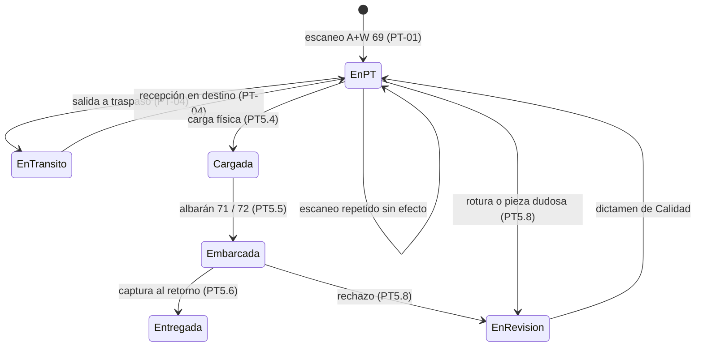
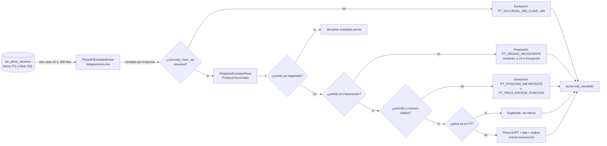

# 01 · Diseño E08 — Producto Terminado por pieza y sucursal

> **Ticket:** ClickUp 86e3vrh7t (E08). **Habilita:** F1-PT-01 (86e3jvuk2, PT5.1), F1-PT-02 (86e3jvuka, PT5.2), F1-PT-04 (86e3jvukj, PT5.9), PT5.5 (86e3ke339), U1.5 (86e3jvv6z).
> **Estado:** **aprobado por Eliam el 27-oct-2026 con ajustes** (Rev. 2, ya aplicados). Lo que no confirma Millet o el código va marcado **SUPUESTO**.
> **Parte de:** nuestro borrador del 24-oct, ajustado a la ficha PT-01 del 26-oct y al plano 1.7.1 «09 · Producto terminado, salida y entrega» (cuando chocan, manda el plano).
> **Verificado contra:** `develop` 3c834939.

## 0. Contexto y alcance

- Hoy la pieza terminada solo existe en A+W y en el Portal de Salidas. En `backend/src` no existe el módulo `ProductoTerminado`, ni lectura de escaneo, ni los estatus 69/70/71/72/115.
- Este diseño fija lo que PT-01 construye (módulo, pieza, puente de escaneo, bandeja y evento). También fija los contratos que usarán PT-02, PT-04, PT5.5, PT5.12 y U1.5. De esas tareas solo se nombran interfaces: ruta, albarán, traspaso y valuación se diseñan en su propia tarea.
- Volumen de referencia: 1,200 piezas al día normal y 2,500 en pico (cuestionario 02).

## 1. Decisiones que se conservan

| # | Decisión | Fuente |
|---|---|---|
| E1 | La pieza entra a PT en **69** (entrada física). El **70** es la liberación financiera. «69 no significa 70». | V11 cerrada 10-oct; plano 1.7.1 §6 y Regla 2 |
| E2 | El PT se controla **por pieza y sucursal**, no como stock de catálogo. No usa la variante de medida de MP-01 (E07 D4 limita las variantes al vidrio crudo). | Registro 16, 10-oct; Jorge 7-oct |
| E3 | Identidad de la pieza = **pedido + posición + número de pieza**. No se crea existencia anónima. | Plano 1.7.1 §6 y §8 |
| E4 | El pedido queda cubierto por sus anticipos timbrados ligados, los cobros de sus facturas y los anticipos previos ligados con #208. Las notas de crédito reducen el total. Uziel expone el saldo por pedido en un puerto de Facturación. Mientras tanto usamos un adaptador provisional marcado (en Demo, uno con saldo de prueba). La ruta REPARTO (crédito 24 h) libera sin verificar pago ni completitud. | Decisión E4; Eliam 27-oct |
| E6 | La liberación a 70 es **por dinero, no por completitud**: un pedido parcial puede pasar a 70. Si está completo se revisa en la carga (PT5.4); sacar un pedido incompleto pide autorización ahí. | Eliam 27-oct; plano 1.7.1 «Actualizar completitud» → «Verificar saldo»; ficha PT5.2 (8 de 10 pasa a 70 al cobrar) |
| E5 | Lectura de A+W por lotes, sin CDC hasta los servidores nuevos. El formato real del aviso solo bloquea encender el canal real (A+W-QA-7). | Jorge 7-oct; P-005; P-006 |

## 2. Módulo, esquema y fronteras

**Hoy (verificado):**

- Selector Demo/Real por ciclo: `backend/src/Integraciones.Aw/Infrastructure/Origen/AwOrigenSesion.cs` y `AwOrigenSelectores.cs`. Demo usa PostgreSQL `millet_aw_origen` (#200). Real abre SQL Server con TLS verificado (#199).
- Patrón de tabla puente con candado (flujo 3, OTR), descrito en `docs/integration/09-aw-otr-exportacion.md`:
  - El puerto vive en el módulo que consume: `backend/src/ComercioExterior/Application/Ports/IOtrIntercambio.cs:3-15`.
  - El adaptador SQL vive en `backend/src/Integraciones.Aw/Infrastructure/Exportacion/OtrTablasAdapter.cs`.
  - El worker (`backend/src/Integraciones.Aw/Infrastructure/Exportacion/Workers/OtrWorkers.cs`) tiene opciones en l.17, candado de proceso `pg_try_advisory_lock` en l.55, control idempotente en l.71 y acuse a la tabla puente en l.103.
  - Real solo se registra con `ContratoI134Firmado` (`backend/src/Integraciones.Aw/Infrastructure/Exportacion/DependencyInjection.cs:29`).
  - Control único `(EmpresaId, IdOrigen, VersionOrigen)` en `backend/src/ComercioExterior/Infrastructure/Persistence/ComercioExteriorDbContext.Otr.cs:11`.
- Pedido ingerido en Facturación:
  - `backend/src/Facturacion/Domain/Pedidos/PedidoFacturable.cs`: `NumeroPedido` l.28, `SucursalId` l.30, `EstadoOrigen` l.73, `CondicionPagoOrigen` l.121 (catálogo `KA_ZAHLBED`: CONTADO, REPARTO…).
  - `PedidoFacturableLinea.cs`: `Posicion` l.16, `Cantidad` l.23. En el canal real, `Cantidad` = `PP_MENGE` (`docs/operacion/aw-integracion-scripts/03_create_views.sql:207`), es decir, piezas.
- Puerto inverso para leer pedidos desde otro módulo: `backend/src/ComercioExterior/Application/Ports/IPedidosEmbarcablesReadPort.cs`, con adaptador `backend/src/Facturacion/Infrastructure/PublicAdapters/PedidosEmbarcablesReadAdapter.cs:12-13`.
- Sucursal por clave A+W: `backend/src/Integraciones.Aw/Application/Pedidos/ISucursalPorClaveAwResolver.cs` (columna `compartido.sucursales.clave_aw`).
- Decisión de CxC: `DecisionLiberacionEmitidaEvent`, en `backend/src/CuentasPorCobrar/Application/Integration/CuentasPorCobrarIntegrationEvents.cs:55-68`. Publica `cuentas_por_cobrar.decision-liberacion.emitida.v1` con `PedidoRef` y `Resultado` (`Liberado`, `LiberadoConOverride`, `Retenido`; reglas en `backend/src/CuentasPorCobrar/Application/Liberacion/DecidirLiberacionCommand.cs:19-25`).
- No existe saldo por pedido en Facturación (sin coincidencias de `SaldoPedido` ni `saldo-liquidado`). #208 (anticipos previos ligados al importar) sigue abierto.

**Decisiones:**

- **D1. Módulo nuevo `ProductoTerminado`**, hexagonal como `ComercioExterior`:
  - Proyecto `backend/src/ProductoTerminado/Millet.ProductoTerminado.csproj` (nuevo) con carpetas Domain/Application/Infrastructure.
  - `ProductoTerminadoDbContext` con `SchemaName = "producto_terminado"`, outbox propio y topic `producto-terminado-events`.
  - Alternativa descartada: meterlo en Almacén (su kardex es de insumos y su saldo es por artículo y ubicación) o en Facturación.
- **D2. Sin FK entre esquemas.** `pedido_facturable_id` y `sucursal_id` son `uuid` planos (ADR-0005: sin FK entre esquemas; ADR-0030: un `DbContext` por módulo). El pedido se lee por un puerto `IPedidosPtReadPort` definido en PT (`Application/Ports`) e implementado en `backend/src/Facturacion/Infrastructure/PublicAdapters/PedidosPtReadAdapter.cs` (nuevo), mismo molde que `PedidosEmbarcablesReadAdapter`. Devuelve cabecera (id, número, sucursal, estado, `CondicionPagoOrigen`, cliente, moneda, total, versión de origen) y líneas (posición, producto, descripción, cantidad, unidad SAT). Cliente, moneda y total viajan en el evento de retención para que CxC decida sin volver a leer el pedido (§6).
- **D3. Solo Integraciones.Aw toca A+W.** El lector de escaneos y el futuro retorno de estatus viven en `Integraciones.Aw`. PT no abre conexiones a `MILLET_INTEGRACION`.
- **D4. PT es dueño de la existencia por pieza y del estado retenido/liberado del pedido.** Facturación es dueña del saldo, CxC de la decisión de crédito y A+W del estatus visible para ventas.

## 3. Modelo

| Tabla (`producto_terminado`) | Llave e índices | Contenido |
|---|---|---|
| `pedidos_pt` (raíz) | PK `id`; único `(empresa_id, numero_pedido)`; índice `(empresa_id, sucursal_venta_id)` | `pedido_facturable_id`, `numero_pedido`, `sucursal_venta_id` (de `PedidoFacturable.SucursalId`), `sucursal_entrega_id` (**SUPUESTO** S3), `condicion_pago_origen` (copia), `version_origen`, `xmin` como ETag. En PT-02 se agregan `liberacion` (`Retenido`/`Liberado`), `motivo_liberacion` y `liberado_at`. |
| `pedido_pt_posiciones` (hija) | PK `id`; único `(pedido_pt_id, posicion)` | `producto_id`, `descripcion`, `piezas_esperadas` (entero, de `Cantidad`; 0 para fletes y servicios, S2). Se refresca cuando cambia `version_origen`. |
| `piezas` (hija) | PK `id`; **único `(pedido_pt_id, posicion, numero_pieza)`**; índices `(empresa_id, sucursal_id, estado)` y `(pedido_pt_id, estado)` | `sucursal_id` (sede física actual), `estado`, `escaneada_at` (hora de A+W), `estatus_aw` (69), `escaneo_id` del alta. |
| `movimientos_pieza` | PK `id`; único `(pieza_id, tipo, referencia)` | Kardex por pieza: `tipo` (PT-01 solo `Alta`), `sucursal_origen_id`, `sucursal_destino_id`, `estado_anterior`, `estado_nuevo`, `referencia` (escaneo, albarán, traspaso), `ocurrido_at`, `usuario`. Ningún paso se aplica dos veces. |
| `escaneos` (bitácora y bandeja) | PK `id`; **único `(empresa_id, origen, origen_evento_id)`**; parcial `WHERE resultado IN ('Pospuesto','Excepcion')` | Copia de la fila del puente: pedido, posición, número de pieza, clave de sucursal A+W, `escaneado_at`, `usuario_aw`, `estatus_aw`, `resultado`, `motivo`, `intentos`, `pieza_id`, `resuelto_por`, `resuelto_at`. |
| `outbox` | patrón existente | Eventos de §6. |

- **D5. No guardamos piezas «esperadas» como filas.** Las esperadas salen de `pedido_pt_posiciones` y las faltantes son los números 1..N que no tienen fila en `piezas`. Así evitamos unas 900 mil filas al año que solo dicen «todavía no». Alternativa descartada: crear una pieza `Esperada` por unidad (borrador del 24-oct).
- **D6. Idempotencia en dos niveles.** (1) Por evento de origen: el mismo `evento_id` reutiliza su resultado (CA5.9). (2) Por pieza: otro evento para una pieza que ya está en PT queda como `Duplicado`, sin movimiento. Plano 7.1 p2: «un evento repetido reutiliza resultado».
- Volumen: unas 900 mil piezas al año. Sin particionar; lo revisamos con datos reales.

## 4. Estados de la pieza y del pedido

PT-01 solo construye `EnPT`. Los demás estados son el contrato para las tareas siguientes y no se programan antes. La pieza cambia de sucursal únicamente por un movimiento, nunca editando `sucursal_id`.

**Cómo sube al pedido (consulta, no columna guardada):**

| Indicador (PT-02) | Cálculo |
|---|---|
| esperadas | Σ `piezas_esperadas` |
| terminadas | piezas con movimiento `Alta` (aunque ya hayan salido) |
| en PT | piezas en `EnPT`, por sucursal |
| cargadas / entregadas | piezas en `Cargada`+`Embarcada` / `Entregada` (en 0 hasta PT5.4 y PT5.6) |
| backorder | esperadas − terminadas |
| avance físico | `SinPiezas` (0), `Parcial`, `Completo` (terminadas = esperadas) |
| liberación | `Retenido` (69) o `Liberado` (70), guardado en `pedidos_pt`; **independiente del avance físico** (E6): un `Parcial` puede estar `Liberado` |

## 5. Entrada desde A+W

**Tabla puente propuesta por el ERP** `MILLET_INTEGRACION.dbo.aw_pieza_escaneo` (nombre de la ficha). Script para Jorge, **sin ejecutar**: `docs/operacion/aw-integracion-scripts/10_create_pieza_escaneo.sql` y `11_grant_pieza_escaneo.sql` (nuevos, molde `07_create_otr_tables.sql` y `08_grant_otr.sql`). La misma tabla va en `tools/aw-origen-demo/schema.sql`, y los eventos DEMO en `tools/aw-origen-demo/piezas.sql` (nuevo).

| Columna | Regla |
|---|---|
| `evento_id` varchar(100) PK | Id del evento de A+W. Si A+W no tiene uno, TI lo arma como `pedido|posición|pieza|tipo_evento` (S5). **Llave de idempotencia.** |
| `tipo_evento` | `ALTA_PT` (una pieza) o `ALTA_PT_PEDIDO` (taller de sucursal, **SUPUESTO** S8). Otros tipos se agregan en PT5.8 o PT-04 |
| `numero_pedido`, `numero_posicion`, `numero_pieza` | identidad de la pieza; `numero_pieza` ≥ 1. En `ALTA_PT_PEDIDO`, `numero_pieza` va nulo y `numero_posicion` es opcional (nulo = todas las posiciones) |
| `cantidad_piezas` | solo `ALTA_PT_PEDIDO`: cuántas piezas da de alta el aviso; nulo = todas las faltantes |
| `codigo_barras` | opcional, para cotejo físico |
| `sucursal_clave_aw` | sede donde se escaneó |
| `estatus_aw` | 69 |
| `escaneado_at`, `usuario_aw`, `creada_at` | hora y usuario del escaneo |
| `erp_resultado`, `erp_motivo`, `erp_procesada_at` | acuse del ERP (molde `aw_otr_envio`) |

Índice de pendientes `WHERE erp_resultado IS NULL OR erp_resultado = 'Error'`, igual que `ix_aw_otr_pendiente`.

**Flujo (lote, no CDC):**

- **Canal:** `PiezasPtOrigenSelector` en `backend/src/Integraciones.Aw/Infrastructure/PiezasPt/` (nuevo), copia de `OtrOrigenSelector` (`backend/src/Integraciones.Aw/Infrastructure/Exportacion/DependencyInjection.cs:37`): claves `Demo`/`Real` según `AwOrigenSesion`.
- **Configuración:** sección `IntegracionesAw:PiezasPt` (`EntradaHabilitada=false`, `EmpresaId`, `IntervalSeconds=30`, `BatchSize=200`, `MaxIntentos=5`, `PospuestoHoras=24`, `ContratoI134Firmado=false`). Real solo se registra con contrato firmado y cadena `AwIntegracionDb`. Demo nunca en Production.
- **Quién reintenta:** la fila del puente se acusa con el resultado del primer intento. Los `Pospuesto` se reintentan desde `producto_terminado.escaneos`, no volviendo a leer SQL Server, para no cargar SER-DATA.
- **Bandeja:** una persona con permiso puede `Reintentar` o `Descartar` con motivo (molde `DescartarReppPendienteCommand(Id, Motivo)` en `backend/src/Facturacion/Application/Repp/Pendientes/ReppPendienteCommands.cs:15`). Ninguna acción crea pieza fuera del comando.
- **Identidad incompleta:** un evento `ALTA_PT` sin `numero_pieza` o de un pedido `Cancelado` va a `Excepcion`. No creamos existencia anónima (plano §6).
- **Alta por pedido (taller de sucursal, SUPUESTO S8).** El taller marca 69 por pedido (vidrio al corte, hojas de call center), no por pieza. Un aviso `ALTA_PT_PEDIDO` da de alta las N piezas del pedido, o de la posición si viene:
  - Asigna los números faltantes más bajos de cada posición (1..`piezas_esperadas` sin fila en `piezas`), en orden de posición.
  - Cada pieza queda con identidad completa (pedido + posición + número), su `Alta` y su `pieza.ingresada.v1`. No hay existencia anónima.
  - Si `cantidad_piezas` supera las faltantes, da de alta las faltantes y el resto queda como `Excepcion PT_PIEZA_EXCEDE_POSICION`.
  - La idempotencia sigue por `evento_id`: repetir el aviso devuelve el resultado previo.
  - Cómo llega ese aviso desde A+W se le pregunta a Jorge (Q4). Mientras contesta se construye con este formato.
- **Fuera de orden:** se conserva y nunca retrocede una pieza ya avanzada (plano §12).
- **Capacidad:** 200 filas cada 30 s son 24,000 por hora, muy por encima del pico de 2,500 al día.

## 6. 69 → 70: contrato y eventos

**Regla (PT-02).** El pedido entra a `Retenido` (69) con su primera pieza en PT. Pasa a `Liberado` (70) **por dinero, sin exigir pedido completo** (E6), cuando se cumple una de estas condiciones. PT registra la liberación directo, con su motivo (Q3):

1. **Saldo cubierto** (`SaldoCubierto`). `ISaldoPedidoReadPort.ObtenerAsync(empresaId, numeroPedido)` devuelve saldo ≤ 0. Ese saldo es el total menos notas de crédito, menos anticipos timbrados ligados, menos cobros de facturas y menos anticipos previos ligados (#208) (decisión E4). El puerto lo define PT y lo implementa Uziel en `Facturacion/Infrastructure/PublicAdapters`. Mientras no exista:
   - **Real:** `SaldoPedidoProvisionalAdapter` devuelve «no cubierto», con `PLATFORM-TODO(<SaldoPorPedidoFacturacion>)`. Nunca libera por error; solo liberan REPARTO y CxC.
   - **Demo:** `SaldoPedidoDemoAdapter` guarda un saldo de prueba por pedido (tabla `producto_terminado.saldos_demo`, arranca en el total del pedido). Un endpoint solo de Demo, `PUT /api/v1/producto-terminado/demo/pedidos/{numero}/saldo`, lo pone en 0 (simula el cobro de caja) y dispara la reevaluación. Así se demuestra el caso de 8 de 10 piezas que se libera al cobrar. Se elige por `AwOrigenSesion` (Demo/Real), como el lector de escaneos, y nunca se registra en Production.
2. **REPARTO** (`Reparto`). `CondicionPagoOrigen = 'REPARTO'` (crédito 24 h) libera sin verificar pago ni completitud (Q2).
3. **Decisión de CxC** (`DecisionCxc`). Llega `cuentas_por_cobrar.decision-liberacion.emitida.v1` con `Resultado` `Liberado` o `LiberadoConOverride` para ese `PedidoRef` (S10). Aplica al recibirse, aunque el pedido esté incompleto.

**Quién le pide la decisión a CxC (reglas por serie).** CxC ya tiene reglas por serie de folio (5000 y 7000 siempre liberan; 3000, 4000 y 8000 nunca) en `DecidirLiberacionCommand`, pero hoy solo se dispara a mano. El disparo queda así:

- Al entrar a 69, PT evalúa primero saldo y REPARTO. Si libera, publica directo `Liberado` y CxC no interviene.
- Si queda `Retenido`, publica `pedido.estado-cambiado.v1` con `estado = Retenido`, cliente, moneda y total del pedido.
- CxC consume ese evento con un handler nuevo, `SolicitarDecisionAlRetenerHandler`, en `CuentasPorCobrar/Application/Liberacion`. Ese handler llama `DecidirLiberacionCommand(PedidoRef, ClienteId, Moneda, MontoPedido, OverrideId: null)` como usuario de sistema.
- La cascada serie → crédito → override decide. Su `decision-liberacion.emitida.v1` regresa a PT (condición 3). Las series 5000/7000 se liberan solas y las demás siguen la regla de crédito.
- Idempotencia: una decisión automática por `(PedidoRef, entrada a 69)`. Si el pedido vuelve a evaluarse, CxC no repite la decisión automática. Las autorizaciones manuales siguen por su endpoint.

**Cuándo se reevalúa un pedido `Retenido`** (`EvaluarLiberacion`):
- al dar de alta piezas;
- al llegar una decisión de CxC;
- al poner el saldo de prueba en 0 (Demo);
- con un barrido cada 15 min de los pedidos retenidos, porque Facturación no publica un evento de cobro. Cuando Uziel publique cambio de saldo, el barrido se reemplaza por ese evento.

Si el pedido está completo se revisa en la carga (PT5.4). La salida de un pedido incompleto con autorización (Tema 57, P-110) queda fuera de PT-02.

| Evento | Emite | Cuándo | Consume |
|---|---|---|---|
| `producto_terminado.pieza.ingresada.v1` | PT (PT-01) | pieza a `EnPT` | PT-02; Contabilidad/PT5.12 (entrada a PT y salida de producción en proceso, agrupado por día y sede) |
| `producto_terminado.pedido.estado-cambiado.v1` | PT (PT-02) | entra a 69 (`Retenido`, con cliente, moneda y total) o pasa a 70 (`Liberado`, con `motivo`: SaldoCubierto, Reparto, DecisionCxc) | U1.5 (escribe 70 en `aw_retorno`); CxC (pide su decisión al recibir `Retenido`; se entera de la liberación) |
| `cuentas_por_cobrar.decision-liberacion.emitida.v1` | CxC (existe) | CxC decide | PT-02 |
| saldo por pedido (puerto, no evento) | Facturación (Uziel) | consulta al evaluar | PT-02 |

**Nombre del evento.** La ficha PT5.2 decía `producto_terminado.pedido.liberado.v1`. Nos quedamos con `pedido.estado-cambiado.v1`, porque también lleva la entrada a 69 que dispara la decisión de CxC. Eliam actualiza la ficha.

Entrega local de eventos (C1.8, `backend/src/Api/Infrastructure/EntregaLocalIntegrationEventsExtensions.cs`) mientras no exista el topic en `infra/modules/servicebus.bicep`.

Plano 1.7.1 §11: «sin acuse no afirmar liberado en A+W». El estado `Liberado` es del ERP; el acuse del 70 en A+W lo guarda Integraciones.Aw.

## 7. Lo que consumirán las tareas siguientes (solo interfaces)

| Tarea | Interfaz |
|---|---|
| PT-02 (PT5.2) | Consulta `EstadoPedidoPt(numeroPedido)` con los indicadores de §4 por sucursal; comando `EvaluarLiberacion(pedidoPtId)` con los disparos de §6; columnas de liberación en `pedidos_pt`; adaptador de saldo Demo; handler de CxC `SolicitarDecisionAlRetenerHandler`. |
| PT-04 (PT5.9) | Movimientos `TrasladoSalida` y `TrasladoRecepcion` con `referencia = traspaso_id`; estado `EnTransito`; la pieza conserva su costo de origen. La recepción parcial deja tránsito pendiente. Nada de esto se construye en PT-01: el modelo ya separa sede física de sede de entrega. |
| PT5.5 (albarán, 71) | `RegistrarSalida(albaranId, piezaIds)`, idempotente por `(pieza, Salida, albaranId)`, que solo acepta piezas `Cargada`. El 71 lo genera A+W o el ERP según P-021. Si es A+W, la lectura del 71 es otro tipo de evento en el mismo patrón de puente. |
| U1.5 (retorno a A+W) | Consume `pedido.estado-cambiado.v1` y escribe en `aw_retorno` (P-007), desde Integraciones.Aw. PT no escribe en A+W. |
| PT5.12 | `pieza.ingresada.v1` lleva `piezaId`, pedido, posición, `productoId`, sucursal y fecha; el costo se agrega allá. |

## 8. Permisos y sucursal

- Nuevos en `backend/src/Identidad/Domain/PermisosCanonicos.cs`: `producto_terminado.piezas.ver`, `producto_terminado.piezas.ver-todas-sucursales`, `producto_terminado.excepciones.gestionar` y `producto_terminado.excepciones.gestionar-todas-sucursales`. Mismo patrón que `almacen.*.leer-todas-sucursales`.
- Las listas de piezas se filtran por `piezas.sucursal_id` contra las sucursales del usuario, salvo con permiso de todas.
- Un escaneo sin sucursal resuelta solo lo ve quien tiene alcance corporativo, igual que `SUCURSAL_NO_DETERMINADA` en `backend/src/Api/Web/DocumentoSucursalScope.cs`. Ahí se agregan los tipos `pieza_pt` y `escaneo_pt` con un `IProductoTerminadoSucursalReadPort` (molde `ComercioExteriorSucursalReadAdapter.cs`).
- El reparto fino por rol y sede (Tema 60) es P-156. Mientras tanto, el rol de Logística/Almacén PT recibe `ver` y `excepciones.gestionar`.

## 9. Migraciones, despliegue y orden

| Orden | Cambio | Dónde |
|---|---|---|
| 1 | Proyecto, `ProductoTerminadoDbContext`, migración `ProductoTerminadoEsquemaInicial` (tablas de §3 sin columnas de liberación) | `backend/src/ProductoTerminado/` (nuevo) |
| 2 | Registro de `DbContext` con `OutboxSaveChangesInterceptor`, outbox `producto-terminado-events` y tipo en `MigrationsHealthCheckOptions`, que revisa `MigrationsAppliedHealthCheck` | `backend/src/Api/Program.cs` (molde l.957-960, 1390-1394 y 1411-1432) |
| 3 | Agregar `ProductoTerminadoDbContext` al bucle de migraciones con su `case`. `ComercioExteriorDbContext` y `ActivosFijosDbContext`, que hoy faltan en el bucle aunque el health check los revisa, van en un PR aparte a develop, no dentro de PT. | `.github/workflows/deploy-app-dev.yml:212` |
| 4 | Permisos y asignación al rol | `PermisosCanonicos.cs` y semilla de roles |
| 5 | Puerto de pedido y su adaptador en Facturación | §2 D2 |
| 6 | Puente: scripts SQL sin ejecutar, tabla y `piezas.sql` en el origen demo, guía de prueba | §5; `docs/operacion/aw-canal-demo-pruebas.md` |
| 7 | Worker, selector y opciones `IntegracionesAw:PiezasPt` | `backend/src/Integraciones.Aw/Infrastructure/PiezasPt/` (nuevo) |
| 8 | Bandeja (API y pantalla mínima: piezas por pedido y sucursal, excepciones) | `backend/src/Api/Endpoints/ProductoTerminado/`, `frontend/src/features/producto-terminado/` (nuevos) |
| 9 (PT-02) | Columnas de liberación, `ISaldoPedidoReadPort` con adaptador provisional (Real) y de saldo de prueba (Demo, tabla `saldos_demo`), consumo del evento de CxC, handler de CxC que pide la decisión al retener, barrido de retenidos | §6 |

### Dependencias de plataforma pendientes (ADR-0031)

| Pieza | Ticket | NoOp en uso | Cómo se conecta |
|---|---|---|---|
| Canal real del puente | A+W-QA-7 / I13.4 | `ContratoI134Firmado=false`; solo Demo | Jorge ejecuta los scripts 10 y 11 y se firma el contrato |
| Saldo por pedido | Facturación (Uziel) | Real: `SaldoPedidoProvisionalAdapter` «no cubierto». Demo: `SaldoPedidoDemoAdapter` con saldo de prueba | `PLATFORM-TODO(<SaldoPorPedidoFacturacion>)` |
| Evento de cambio de saldo | Facturación (Uziel) | barrido de retenidos cada 15 min | se cambia el barrido por la suscripción |
| Topic `producto-terminado-events` | infra | entrega local C1.8 | `infra/modules/servicebus.bicep` |
| Retorno 70 a A+W | U1.5 | ninguno (PT solo publica) | `aw_retorno`, P-007 |

## 10. Pruebas

**Unitarias** (`backend/tests/ProductoTerminado.UnitTests/`, nuevo):

- Alta única por `(pedido, posición, pieza)`.
- Mismo evento dos veces devuelve el resultado previo.
- Evento distinto para la misma pieza da `Duplicado`.
- `numero_pieza` mayor que `piezas_esperadas` da excepción.
- Indicadores de §4 con datos parciales.
- Alta por pedido (`ALTA_PT_PEDIDO`): asigna los números faltantes más bajos; un aviso repetido no duplica; un exceso va a excepción.
- Regla 69→70 (PT-02):
  - un parcial con saldo ≤ 0 libera (`SaldoCubierto`);
  - REPARTO libera incompleto y sin pago;
  - una decisión de CxC libera un parcial;
  - el adaptador provisional Real nunca libera.
- Disparo a CxC: `Retenido` pide una sola decisión automática. La serie 5000 libera y la 3000 retiene (reglas de `ReglasLiberacionSerie`).

**Worker** (`backend/tests/Integraciones.Aw.UnitTests/PiezasPt/PiezasPtWorkersTests.cs`, molde `Exportacion/OtrWorkersTests.cs`): sin `ContratoI134Firmado`, Real no se registra ni abre conexión; candado por empresa; acuse best-effort.

**Integración con el origen Demo** (`backend/tests/Api.IntegrationTests/ProductoTerminado/`, molde `ComercioExterior/OtrHttpTests.cs`):

| Caso | Prueba |
|---|---|
| CA5.9 | 900101 posición 1; el mismo evento de la pieza 1 dos veces → una pieza, un movimiento, un evento; el segundo queda como resultado previo |
| PT5.1-a | piezas 1 y 2 → 2 en PT en Circuito con hora de escaneo y estatus 69; 2 eventos `pieza.ingresada` |
| PT5.1-b | pedido 900199 → `Pospuesto`; se ingiere el pedido y se reintenta → entra una vez |
| PT5.1-c | número de pieza mayor que la cantidad de la posición → `Excepcion PT_PIEZA_EXCEDE_POSICION` |
| PT5.1-d | origen Real con contrato sin firmar → lector real sin registrar; Demo funciona |
| CA5.14 (parcial) | 2,500 eventos con 10 % repetidos → 2,250 piezas, cero pérdidas; se reporta el tiempo |
| Plano caso 1 | 8 de 10 → 8 en PT, backorder 2, reenvío sin efecto |
| PT5.2 (PT-02, Demo) | 8 de 10 en PT, pedido `Retenido`; saldo de prueba en 0 → `Liberado` con motivo `SaldoCubierto` y evento `pedido.estado-cambiado.v1` |
| Taller (PT-01, S8) | aviso `ALTA_PT_PEDIDO` de un pedido de 3 piezas → 3 piezas 1..3 en PT, sin excepción |

## 11. Supuestos a validar

1. **S1** `Cantidad` de la línea de A+W es el número de piezas (`PP_MENGE`). Una cantidad no entera hace que la posición no genere piezas y se reporte.
2. **S2** Fletes y servicios no generan pieza (P-057). Se identifican por clave de unidad SAT de servicio (`E48`) en la línea.
3. **S3** La pieza entra a la sucursal donde se escaneó. La sucursal de entrega es la del pedido hasta que Jorge indique el campo real. Una diferencia entre las dos se resuelve con traspaso (PT-04).
4. **S4** Columnas de `aw_pieza_escaneo` según §5, hasta tener el formato real (P-006).
5. **S5** Si A+W no da un id de evento, TI lo arma con pedido, posición, pieza y tipo.
6. **S6** `Pospuesto` reintenta durante 24 h y luego pasa a `Excepcion`.
7. **S7** Frecuencia de lectura: 30 s con lotes de 200 (mismo ritmo que pedidos, P-005). Va en la lista de A+W-QA-8.
8. **S8** El taller de sucursal que marca 69 por pedido y no por pieza (P-057) manda un aviso `ALTA_PT_PEDIDO` al mismo puente, con pedido, posición opcional y cantidad. El ERP le asigna los números de pieza (§5). Se construye así mientras Jorge confirma cómo llega (Q4).
9. **S9** En Real, el adaptador provisional de saldo nunca libera. En Demo, el saldo de prueba arranca en el total del pedido y solo cambia por el endpoint de Demo.
10. **S10** `PedidoRef` del evento de CxC es el número de pedido de A+W.
11. **S11** Medidas y m² de la pieza no entran en PT-01; se leen por puerto cuando las necesiten PT5.5 y PT5.12.
12. **S12** CxC decide automáticamente una sola vez por entrada a 69, como usuario de sistema y sin override.

## 12. Preguntas abiertas

Ya registradas: P-006 (formato del aviso, Jorge), P-057 (quién escanea por pieza), P-007 (`aw_retorno`), P-021 (quién genera 71 y 72), P-110 (salida incompleta), P-156 (permisos por rol y sede), P-005 (frecuencia).

Respondidas por Eliam (27-oct):

| # | Pregunta | Respuesta |
|---|---|---|
| Q2 | ¿REPARTO libera aunque el pedido esté incompleto? | Sí. REPARTO libera sin verificar pago ni completitud (E6). |
| Q3 | ¿La liberación por saldo pasa por CxC o la registra PT? | La registra PT directo, con su motivo. CxC queda para crédito y autorizaciones manuales y se entera por el evento de PT. |

La condición «Completo (P-096)» que tenía la Rev. 1 se quitó (E6); no encontramos fuente de P-096 que la exija.

Pendientes para Jorge (no frenan PT-01):

| # | Pregunta | ¿Bloquea? |
|---|---|---|
| Q1 | ¿Qué campo de A+W dice la sede que entrega cuando es distinta de la sede de venta (venta intersucursal)? Mientras tanto, S3. | PT-04 |
| Q4 | El taller de sucursal marca 69 por pedido (vidrio al corte, hojas de call center): ¿cómo llega ese aviso desde A+W? ¿Trae pedido y posición? ¿Trae cuántas piezas o da todo el pedido por terminado? Mientras tanto, S8. | Canal real del taller |

---
Rev. 1 · 26-oct-2026 · Primera versión sobre el borrador del 24-oct, la ficha PT-01 del 26-oct y el plano 1.7.1.
Rev. 2 · 27-oct-2026 · Aprobado por Eliam con ajustes:
- liberación por dinero, sin exigir completo (E6);
- saldo de prueba en Demo;
- disparo de la decisión de CxC al retener;
- alta por pedido del taller (S8, Q4);
- nombre del evento confirmado;
- migraciones de CE y AF en un PR aparte.
